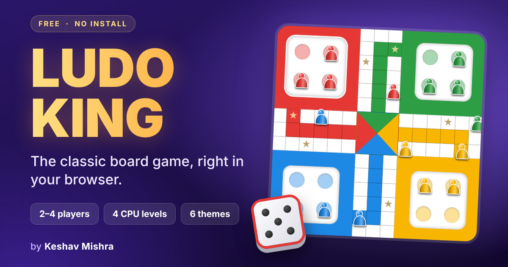

# 🎲 Ludo King

**The classic board game, right in your browser.**
Free, instant and no install.

### [▶&nbsp; Play now](https://mkeshav872-png.github.io/Lodu-King/)

 

## ✨ Features

- **2, 3 or 4 players**: play against the computer or pass the device around with friends
- **4 computer levels**: Easy, Medium, Hard and Pro
- **Two rule sets**: Classic (all 4 tokens home) and Quick (first token home wins)
- **Polished feel**: smooth token animations, dice roll, capture effects and sound
- **Emoji reactions and quick chat**, with a few Hinglish phrases
- **6 themes and 3 token styles**
- **Remembers your settings** on your device
- **Works everywhere**: phone, tablet and desktop, portrait or landscape

## 🎯 How to play

1. Roll a **6** to bring a token out of the yard.
2. Move clockwise around the board, then up your own coloured lane to the centre.
3. Land on an opponent's token on a normal square to send it back to its yard.
4. Star squares and start squares are **safe**, so no captures there.
5. A 6, a capture, or a token reaching home gives you a **bonus roll**.
6. Three 6s in a row and your turn is lost.
7. You need the exact number to reach home.

## 🛠 Run it yourself

The whole game is a single static page. Download or clone this repository and open **index.html** in any browser. Nothing to install and nothing to build.

## 🧰 Built with

Plain HTML, CSS and vanilla JavaScript. Sound is generated live with the Web Audio API, so there are no audio files. Hosted on GitHub Pages.

## 🚧 Coming soon

Online multiplayer with room codes, save and resume, and a Hindi interface.

## 📄 License

Released under the [MIT License](LICENSE).

If you enjoyed the game, a ⭐ on this repository means a lot.

Made by **[Keshav Mishra](https://github.com/mkeshav872-png)**

